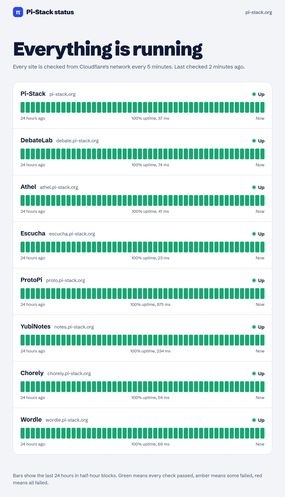

# Pi-Stack status

A Cloudflare Worker that checks every public [Pi-Stack](https://pi-stack.org) site every five minutes and serves a status page with 24 hours of history.



The page is [status.pi-stack.org](https://status.pi-stack.org). The same results are available as JSON at [`/api/status`](https://status.pi-stack.org/api/status).

## Monitored services

The Worker checks these sites, in this order. The short descriptions come from each site's public homepage.

| Service | URL | Public description |
| --- | --- | --- |
| Pi-Stack | https://pi-stack.org/ | AI products built on Claude, led by DebateLab |
| DebateLab | https://debate.pi-stack.org/ | AI debate practice for students and competitive debaters |
| Athel | https://athel.pi-stack.org/ | Interactive story set in an underwater city |
| Escucha | https://escucha.pi-stack.org/ | Confidential channel for a school community |
| ProtoPi | https://proto.pi-stack.org/ | Prototype deployment and review system |
| YubiNotes | https://notes.pi-stack.org/ | YubiKey-only notes |
| Chorely | https://chorely.pi-stack.org/ | Device-local demo of family chores, tokens, and rewards |
| Wordle | https://wordle.pi-stack.org/ | Configurable word-guessing game with offline play |

ProtoPi and YubiNotes answer with a login redirect. A redirect still counts as up, because the site itself responded.

## How it works

A [Cron Trigger](https://developers.cloudflare.com/workers/configuration/cron-triggers/) runs every five minutes (`*/5 * * * *`). Each run requests the eight sites from Cloudflare's network. Redirects are not followed, and each request gives up after 10 seconds. A status below 400 is stored as up. A 4xx or 5xx response, a timeout, or a network error is stored as down.

The run writes one Workers KV key, `state`, through the `STATE` binding. That key holds the latest result for each site and 288 samples, which is 24 hours at one sample every five minutes. One write per run is 288 writes a day, under the Workers Free plan limit of [1,000 KV writes a day](https://developers.cloudflare.com/kv/platform/limits/).

The page turns those samples into 48 bars, one per half hour. Green means every check in the block passed, amber means some failed, red means all of them failed, and grey means the block has no sample yet. The HTML refreshes once a minute. Page and API responses are cached for 30 seconds.

`/api/status` returns `checkedAt` and one object per site: `name`, `host`, `url`, `ok`, `code`, `ms`, and `uptime`. `uptime` is the percentage of stored samples, or `null` before the first check. The bar series is only on the HTML page.

If the KV key is missing, the first request to `/` or `/api/status` runs the checks itself and stores them. Any other path, and any method other than GET or HEAD, does not.

## Tech stack

- [Cloudflare Workers](https://developers.cloudflare.com/workers/) for the cron job and the HTTP server
- [Workers KV](https://developers.cloudflare.com/kv/) for the 24-hour history
- [Wrangler](https://developers.cloudflare.com/workers/wrangler/) for local development and deploys
- `src/index.js`, with no frontend framework and no build step beyond Wrangler's bundle

## Quick start

Requires Node.js 22 or newer.

```bash
npm install
npm test
npm run dev
```

`npm test` checks the Worker without calling the real sites. `npm run dev` starts a local Worker with a local KV store, so the page waits for a check before it has history. `npm run lint` syntax-checks the source. `npm run build` bundles the Worker with `wrangler deploy --dry-run` and does not deploy it.

GitHub Actions runs the test, lint, and build scripts on every push and pull request.

To deploy a copy:

1. Run `npx wrangler login`, or export `CLOUDFLARE_API_TOKEN` with permission to edit Workers on the target account.
2. If that login can see more than one account, export `CLOUDFLARE_ACCOUNT_ID`. The account id is not in `wrangler.jsonc`.
3. Create a namespace with `npx wrangler kv namespace create STATE` and put its id in `kv_namespaces`. The id already in the file is the production namespace for status.pi-stack.org. It belongs to that account. A fork needs its own.
4. Run `npm run deploy`.

## License

[MIT](LICENSE).
